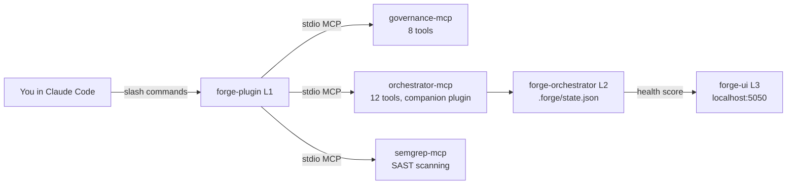

# L1 → L2 → L3: The Level-Up Journey

> Three products. Three levels. Each one works alone. Together they're a force multiplier. You choose your depth based on your pain.

---

## The 60-Second Version

| | L1: Vibe Coder | L2: Pro Builder | L3: Ship Lord |
|---|---|---|---|
| **Product** | forge-plugin | + forge-orchestrator | + forge-ui |
| **Install** | `claude plugin install nxtg-forge` | + `curl -fsSL https://forge.nxtg.ai/install.sh \| sh` | + `git clone --branch v3.5.5 https://github.com/nxtg-ai/forge-ui && cd forge-ui && npm install && npm run dev` |
| **What it adds** | 33 agents, 24 commands, 27 skills, 27 hook registrations, 8 MCP tools | + 12 MCP tools, task management, knowledge persistence, drift detection, TUI | + Web dashboard with a health score, Infinity Terminal, command center, opt-in multi-device access |
| **Setup time** | 30 seconds | + 2 minutes | + 5 minutes |

---

## L1: Vibe Coder (Plugin Only)

**Who it's for:** Solo developers using Claude Code who want quality checks, agent specialists, and governance without leaving the terminal.

**What you get:**
- 33 specialized agents (security, testing, API design, database, UI, performance, etc.)
- 24 slash commands (`/nxtg-forge:feature`, `/nxtg-forge:status`, `/nxtg-forge:test`, etc.)
- 27 knowledge skills that auto-load based on context
- 27 hook registrations (including 4 blocking security guards)
- 8 MCP governance tools (health, metrics, git status, tests, security scan)
- 2 MCP servers: governance-mcp (needs Node.js 20+) and semgrep-mcp (if uv or semgrep-mcp is installed). At L2, the companion plugin `nxtg-forge-orchestrator` (same marketplace; install.sh adds it) registers a third, orchestrator-mcp. A server whose runtime is missing connects with no tools and says what to install.

**What L1 can't do:**
- No persistent task tracking across sessions (agents forget between conversations)
- No knowledge capture (learnings from one session don't inform the next)
- No drift detection (can't compare work against your original spec)
- No file locking for multi-tool workflows
- No visual dashboard

**You're ready for L2 when:**
- You run multiple AI tools and they conflict (Forge orchestrates Claude Code, with Codex CLI and Antigravity CLI (`agy`) as task runners)
- You want task progress to survive between Claude Code sessions
- You want learnings from one implementation to inform the next
- You need to detect when work has drifted from your spec

---

## L2: Pro Builder (Plugin + Orchestrator)

**Who it's for:** Developers running multi-tool AI workflows who need coordination, persistent state, and knowledge accumulation.

**What L2 adds to every agent and command:**

| Capability | How It Works | MCP Tool |
|-----------|-------------|----------|
| Task management | Agents check what's assigned, claim work, mark complete | `forge_get_tasks`, `forge_claim_task`, `forge_complete_task` |
| Knowledge persistence | What agents learn in one session informs the next | `forge_capture_knowledge`, `forge_get_knowledge` |
| Drift detection | Compare current work against your original spec/vision | `forge_check_drift` |
| Project state | Shared state file at `.forge/state.json` all tools read | `forge_get_state` |
| Plan awareness | Agents read and follow your `SPEC.md` plan | `forge_get_plan` |
| File locking | Prevents two tools from editing the same file | Built into task system |
| Health scoring | Governance health over documentation, architecture, task health, knowledge coverage and drift | `forge_get_health` |
| Event audit trail | Every action logged to `.forge/events.jsonl` | `forge_get_events` |

**The TUI dashboard:** `forge dashboard` launches a terminal dashboard with task boards, agent activity, and governance metrics — all in your terminal, no browser needed.

**You're ready for L3 when:**
- You want visual oversight (graphs, charts, health gauges)
- You need a terminal that survives browser close and network drops
- You manage a team and want a shared dashboard
- You want multi-device access (phone/tablet monitoring)

---

## L3: Ship Lord (Plugin + Orchestrator + Dashboard)

**Who it's for:** Team leads, power users, and anyone who wants visual governance with persistent terminal sessions.

**What L3 adds:**

| Feature | What It Does |
|---------|-------------|
| **Visual dashboard** | Web UI at `localhost:5050` with a 0-100 health score and the project's governance state; sign-in with an access token |
| **Infinity Terminal** | Browser terminal whose shell keeps running if the tab closes or the network drops; reopen within 5 minutes to return. A server restart ends it |
| **Command center** | Runs project status, tests, a type-check and build pre-flight, and a gap analysis from the browser |
| **Multi-device access** | Off by default (both servers bind `127.0.0.1`). Set `FORGE_UI_HOST=0.0.0.0` and `ALLOWED_ORIGINS` to open it from another device; every request still needs the token |
| **5 engagement modes** | CEO / VP / Engineer / Builder / Founder views — same data, different depth |

---

## How They Connect

**No code dependencies between products.** MCP is the only integration layer. Remove any product and the others keep working.

---

## Is It Worth Upgrading?

### Stay on L1 if:
- You only use Claude Code (no Codex, no Gemini)
- You don't need task state to survive between sessions
- You're working on personal projects or learning
- Terminal commands are your preferred interface

### Upgrade to L2 if:
- You run 2+ AI tools on the same codebase → file locking prevents conflicts
- You want knowledge to accumulate → what agents learn persists
- You're on a team → task assignments coordinate work
- You need drift detection → keeps work aligned with spec

### Upgrade to L3 if:
- You want visual monitoring → dashboard gives bird's-eye view
- You need Infinity Terminal → a shell that survives a closed tab or a network drop
- You manage others → shared dashboard for team visibility
- You present to stakeholders → visual governance is more persuasive than CLI output

---

## Downgrade Path

Each level can be removed independently:
- **Remove L3:** Stop `forge-ui` dev server. Everything else keeps working.
- **Remove L2:** Uninstall the `forge` binary. The plugin keeps working at L1: the companion's stand-in server says the orchestrator is not installed (it is optional), and `/nxtg-forge:status` shows "Not connected".
- **Remove L1:** `claude plugin uninstall nxtg-forge`. You're back to vanilla Claude Code.

No data is lost. `.forge/` directory, governance state, and knowledge files remain on disk.

---

*See also: [Installation](README.md#installation) | [Commands Reference](commands/README.md) | [Agents Reference](agents/README.md)*
